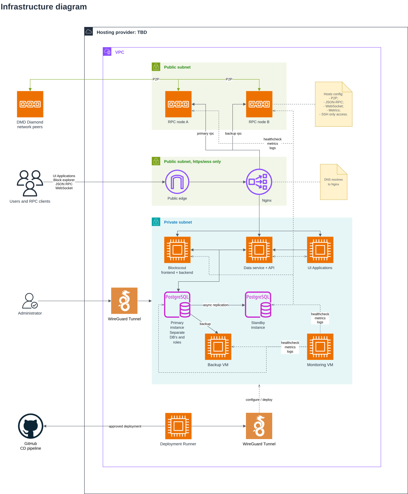
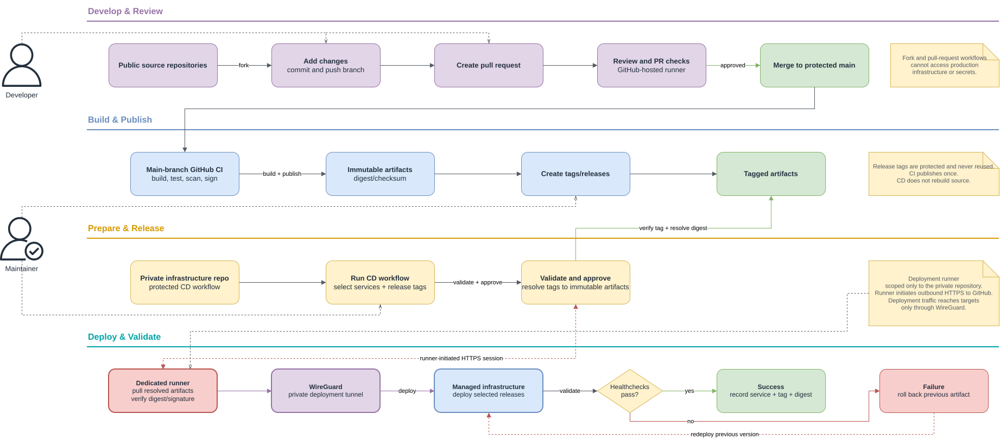

# Migration to managed infrastructure plan

This document defines the migration plan for DMD Diamond production services. The goal is to make the infrastructure more secure, reproducible and manageable.
The decentralized mainnet and the existing 25-node testnet are outside the scope of this migration.

Assumptions:
1. The primary VPS provider is not selected yet; it will be either Hetzner, Contabo, or a comparable provider;
2. The provider supplies VPSs and public networking, but no managed load balancer;
3. The staking UI, Blockscout, and data service will use separate target VMs;
4. All services except blockchain RPC nodes are containerized;
5. RPC nodes continue to run as systemd services.

## 1. Current infrastructure
### 1.1 Existing services and hosting
#### Shared production server
The following services run on one VPS:
- **nginx**
  - Terminates public HTTP/HTTPS traffic;
  - Likely routes Blockscout and the data-service API as well; the exact hostnames and paths must be inventoried.

- **Staking UI**
  - Next.js application.
  - Containerized.
  - Served as `ui.bit.diamonds` through the local nginx instance.
  - Uses an API provided by the data service.

- **Faucet UI**
  - Containerized.
  - Served through the local nginx instance.

- **Token-claiming UI**
  - Containerized.
  - Served through the local nginx instance.

- **RPC node A and RPC node B**
  - Two blockchain node processes on the same VPS.
  - Run as systemd services.
  - Exposed through `rpc.bit.diamonds`, `ws.bit.diamonds` and the local nginx instance.

- **Blockscout**
  - Containerized frontend and backend.
  - Uses PostgreSQL and Redis containers on the same VPS.

- **Data service**
  - Consists of two independently managed parts:
    - a containerized Express server that provides the database-backed API used by the frontend;
    - an indexer service managed by systemd whose `ExecStart` launches the application as a container.
  - Uses PostgreSQL on the same VPS.
  - The Express API reads application data; the indexer worker reads blockchain events and writes database data.

- **PostgreSQL**
  - Containerized.
  - Used by Blockscout and the data service.

- **Redis**
  - Containerized.
  - Used by Blockscout.

#### Source code and pipelines

- Applications and diamond-node source repositories are public and belong to one GitHub organization.
- Public forks and pull requests are allowed.
- Some repositories have a CI pipeline, but they do not publish any artifacts.
- Deployments and server configuration are manual and distributed among several people.

#### Infrastructure not included in this migration

- The decentralized mainnet is operated by independent participants and is out of scope.
- The existing testnet VMs are out of scope for this migration.

### 1.2 Problems with the current infrastructure

1. **One production host is the main failure domain**
   - Failure, disk exhaustion, provider maintenance, or compromise of one VPS can remove the UI, public RPC, explorer, data API, indexer, and databases together.

2. **2 RPC nodes on one VPS do not provide redundancy**
   - They can tolerate an individual process failure.
   - They cannot tolerate loss of the VPS.

3. **Public entry points and backend services are co-located**
   - nginx and every backend run on the same host.

4. **Changes are done manually**
   - Configuration can drift.
   - It is difficult to determine what was changed on host and how to reproduce it.

5. **CI output is not a reusable release**
   - Production may be rebuilt differently.
   - Rollback cannot be correctly done.

6. **Deployment credentials and responsibilities are distributed**
   - Access revocation and auditing are difficult.
   - Public pull-request workflows require a strict boundary from production credentials.

7. **No database backup and recover mechanism exists**

8. **Observability is incomplete**
   - Centralized metrics, logs, alert routing, chain-aware RPC checks, and external outage detection are required.

## 2. Migration scope

### 2.1 In scope

- Staking, Faucet, and Claiming UIs
- Private Express data API and data-indexer worker
- Blockscout frontend and backend
- Blockscout Redis
- Public RPC endpoint and two RPC nodes
- nginx
- PostgreSQL primary and standby
- pgBackRest backup storage
- Private deployment runner
- Metrics, logs, dashboards and alerts
- Reproducible provisioning, host configuration, deployments, rollback, and recovery runbooks

### 2.2 Toolset

| Tool                      |  Purpose                |
| ------------------------- | ----------------------- |
| OpenTofu/Terraform        | Provisions VPSs, networking, firewalls, and DNS where provider APIs support them.            |
| Ansible                   | Configures operating systems, WireGuard, firewalls, Docker, systemd units, exporters, backup, and application configuration. Provides rebuild and recovery playbooks      |
| systemd service           | BC nodes runtime        |
| Docker Compose            | Services runtime        |
| GitHub Releases + GHCR    | Artifacts storage       |
| GitHub Actions            | CI/CD                   |
| WireGuard                 | Provides private service, administration, monitoring, backup, and deployment connectivity |
| Prometheus, Grafana, Loki | Provide metrics, dashboards, centralized logs, alert routing and host log collection |
| pgBackRest/WAL            | PostgreSQL replication and backups |

## 3. Target infrastructure

### 3.1 Infrastructure diagram

The canonical editable diagram is [infrastructure-diagram.drawio](./infrastructure-diagram.drawio).

The diagram uses AWS-style icons only as visual notation. It does not imply that AWS services are used.

### 3.2 Deployment diagram

The canonical editable diagram is [deployment-diagram.drawio](./deployment-diagram.drawio).

It contains four stages:

1. **Develop and review:** fork repository, add changes, create a pull request, run review/checks, and merge into protected main.
2. **Build and publish:** create a protected release tag; CI builds and publishes tagged immutable artifacts.
3. **Select and approve:** run CD in the private infrastructure repository with selected services and tags; validate artifacts and obtain production approval.
4. **Deploy and validate:** the dedicated runner pulls resolved artifacts, deploys through WireGuard, runs health checks, and records success or rolls back.
