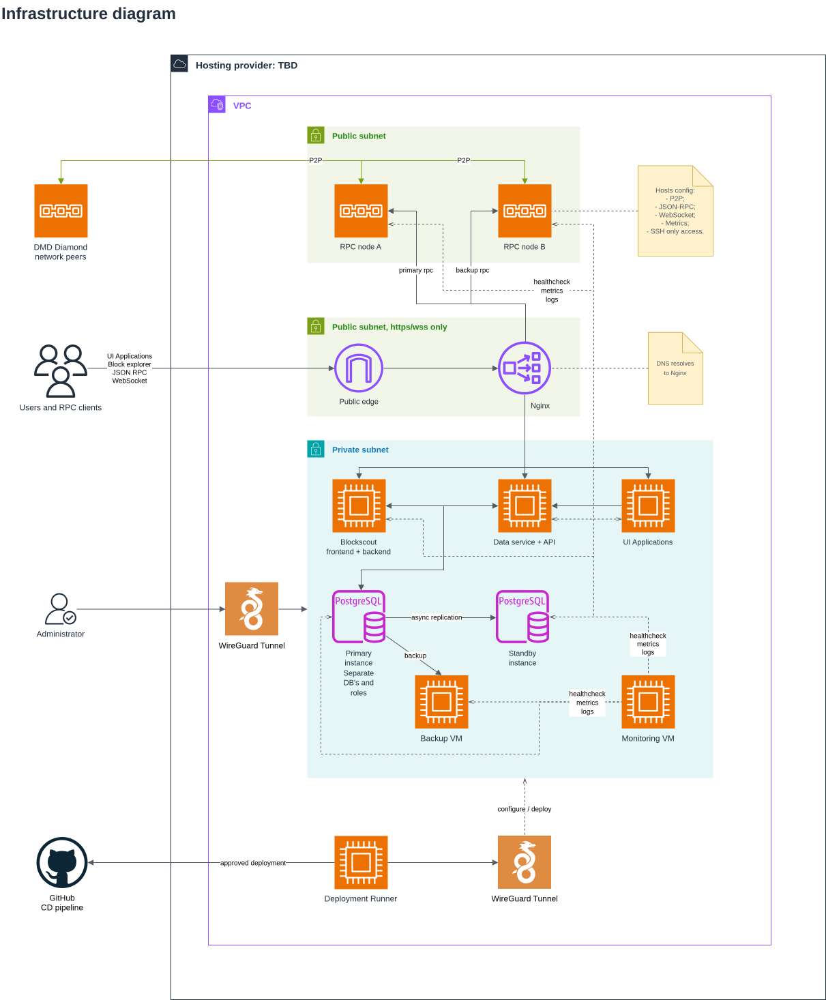
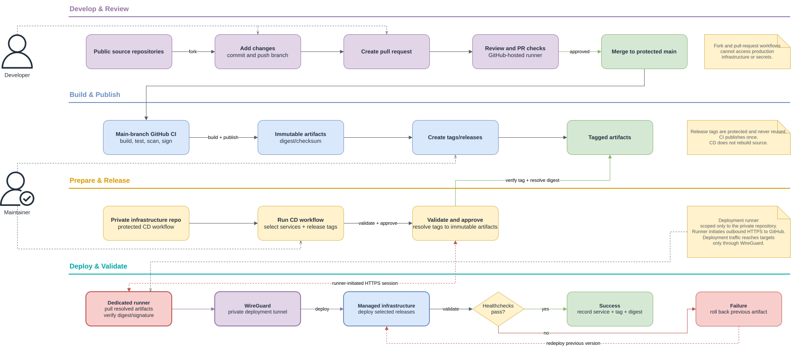

# Migration to managed infrastructure plan

This document defines the migration plan for DMD Diamond production services. The goal is to make the infrastructure more secure, reproducible and manageable.
The decentralized mainnet and the existing 25-node testnet are outside the scope of this migration.

Assumptions:
1. The primary VPS provider is not selected yet; it will be either Hetzner, Contabo, or a comparable provider;
2. The provider supplies VPSs and public networking, but no managed load balancer;
3. The staking UI, Blockscout, and data service will use separate target VMs;
4. All services except blockchain RPC nodes are containerized;
5. RPC nodes continue to run as systemd services.

## 1. Current infrastructure
### 1.1 Existing services and hosting
#### Shared production server
The following services run on one VPS:
- **nginx**
  - Terminates public HTTP/HTTPS traffic;
  - Likely routes Blockscout and the data-service API as well; the exact hostnames and paths must be inventoried.

- **Staking UI**
  - Next.js application.
  - Containerized.
  - Served as `ui.bit.diamonds` through the local nginx instance.
  - Uses an API provided by the data service.

- **Faucet UI**
  - Containerized.
  - Served through the local nginx instance.

- **Token-claiming UI**
  - Containerized.
  - Served through the local nginx instance.

- **RPC node A and RPC node B**
  - Two blockchain node processes on the same VPS.
  - Run as systemd services.
  - Exposed through `rpc.bit.diamonds`, `ws.bit.diamonds` and the local nginx instance.

- **Blockscout**
  - Containerized frontend and backend.
  - Uses PostgreSQL and Redis containers on the same VPS.

- **Data service**
  - Consists of two independently managed parts:
    - a containerized Express server that provides the database-backed API used by the frontend;
    - an indexer service managed by systemd whose `ExecStart` launches the application as a container.
  - Uses PostgreSQL on the same VPS.
  - The Express API reads application data; the indexer worker reads blockchain events and writes database data.

- **PostgreSQL**
  - Containerized.
  - Used by Blockscout and the data service.

- **Redis**
  - Containerized.
  - Used by Blockscout.


#### Source code and pipelines

- Applications and diamond-node source repositories are public and belong to one GitHub organization.
- Public forks and pull requests are allowed.
- Some repositories have a CI pipeline, but they do not publish any artifacts.
- Deployments and server configuration are manual and distributed among several people.

#### Infrastructure not included in this migration

- The decentralized mainnet is operated by independent participants and is out of scope.
- The existing testnet VMs are out of scope for this migration.

### 1.2 Problems with the current infrastructure

1. **One production host is the main failure domain**
   - Failure, disk exhaustion, provider maintenance, or compromise of one VPS can remove the UI, public RPC, explorer, data API, indexer, and databases together.

2. **2 RPC nodes on one VPS do not provide redundancy**
   - They can tolerate an individual process failure.
   - They cannot tolerate loss of the VPS.

3. **Public entry points and backend services are co-located**
   - nginx and every backend run on the same host.

4. **Changes are done manually**
   - Configuration can drift.
   - It is difficult to determine what was changed on host and how to reproduce it.

5. **CI output is not a reusable release**
   - Production may be rebuilt differently.
   - Rollback cannot be correctly done.

6. **Deployment credentials and responsibilities are distributed**
   - Access revocation and auditing are difficult.
   - Public pull-request workflows require a strict boundary from production credentials.

7. **No database backup and recover mechanism exists**

8. **Observability is incomplete**
   - Centralized metrics, logs, alert routing, chain-aware RPC checks, and external outage detection are required.

## 2. Migration scope

### 2.1 In scope

- Staking, Faucet, and Claiming UIs
- Private Express data API and data-indexer worker
- Blockscout frontend and backend
- Blockscout Redis
- Public RPC endpoint and two RPC nodes
- nginx
- PostgreSQL primary and standby
- pgBackRest backup storage
- Private deployment runner
- Metrics, logs, dashboards and alerts
- Reproducible provisioning, host configuration, deployments, rollback, and recovery runbooks


### 2.2 Toolset

| Tool                      |  Purpose                |
| ------------------------- | ----------------------- |
| OpenTofu/Terraform        | Provisions VPSs, networking, firewalls, and DNS where provider APIs support them.            |
| Ansible                   | Configures operating systems, WireGuard, firewalls, Docker, systemd units, exporters, backup, and application configuration. Provides rebuild and recovery playbooks      |
| systemd service           | BC nodes runtime        |
| Docker Compose            | Services runtime        |
| GitHub Releases + GHCR    | Artifacts storage       |
| GitHub Actions            | CI/CD                   |
| WireGuard                 | Provides private service, administration, monitoring, backup, and deployment connectivity |
| Prometheus, Grafana, Loki | Provide metrics, dashboards, centralized logs, alert routing and host log collection |
| pgBackRest/WAL            | PostgreSQL replication and backups |


## 3. Target infrastructure

### 3.1 Infrastructure diagram



The canonical editable diagram is [infrastructure-diagram.drawio](./infrastructure-diagram.drawio).

The diagram uses AWS-style icons only as visual notation. It does not imply that AWS services are used.

### 3.2 Detailed target infrastructure

#### Public edge

DNS for public services resolves to one self-managed edge VPS with configured proxy:

```text
ui.bit.diamonds             -> edge VPS -> UI applications VM
faucet.bit.diamonds         -> edge VPS -> UI applications VM
claiming.bit.diamonds       -> edge VPS -> UI applications VM
rpc.bit.diamonds            -> edge VPS -> RPC A or RPC B
explorer.bit.diamonds       -> edge VPS -> Blockscout VM
```

The edge:
- terminates TLS;
- applies request-size, rate, concurrency, timeout, and WebSocket limits;
- routes RPC requests to RPC A as primary and RPC B as backup;
- forwards backend traffic over WireGuard/private addresses;


> [!IMPORTANT]
> Limitation: The single edge VPS remains a public-endpoint single point of failure.

Its full build, firewall, certificates, routes, and health-check configuration must be reproducible with Ansible.

#### RPC hosts

RPC A and RPC B run on separate VPSs with equivalent capacity.

Public interfaces allow:
- blockchain P2P;
- WireGuard.

Private/WireGuard addresses allow:

- JSON-RPC and WebSocket from the edge VPS and explicitly authorized internal services;
- metrics from the monitoring VPS;
- deployment SSH from the runner;
- named administrative access.

#### Private application services

The UI-applications, Blockscout, and data-service VMs are not directly public. The edge reaches only their required public application ports over WireGuard/private addresses.

- The staking, faucet, and token-claiming UI containers have no database credentials.
- UI server containers call the Express API over the private network and proxy only required responses to browsers.
- Blockscout uses only its PostgreSQL database and role.
- Redis listens only on the Blockscout VM's private container/host network and is not routed by the edge.
- The Express API uses a read-only `data_api` database role where practical.
- The data indexer worker uses a separate `data_indexer`.
- Internal indexer, maintenance, metrics, and administration routes are not exposed publicly.

#### PostgreSQL

One PostgreSQL cluster contains separate databases for Blockscout and the data indexer service. Blockscout has separate application and migration roles. The data indexer service database has separate API-read, write, and migration roles.

The primary and standby:

- use separate VPSs;
- have the same PostgreSQL version and extensions;
- have equivalent CPU, memory, and storage;
- communicate only over WireGuard/private addresses;
- accept SQL only from authorized application hosts;
- expose metrics only to the monitoring VPS.

#### Deployment runner

The runner is a private deployment bridge:

- it is registered only to the private infrastructure repository;
- it initiates outbound HTTPS/WebSocket connections to GitHub;
- GitHub requires no inbound runner port;
- administration is available only through WireGuard;
- target firewalls allow its WireGuard address only to required deployment ports;
- it has no direct PostgreSQL access;
- its service account is unprivileged and is not a member of the Docker group;
- privileged target operations use narrowly scoped, audited sudo wrappers.


> [!WARNING]
> **Security limitation:** On GitHub Free, private repositories have no environments, protected branches, required reviewers, enforceable CODEOWNERS reviews, or rulesets. Any account with write or administrator access can change a workflow and must be treated as a production administrator.

#### Provider and network limitations

- The primary production environment uses one provider.
- A provider-wide network or account outage can remove every live production service.
- WireGuard provides confidentiality and peer authentication, but host firewalls still provide port-level authorization.
- A public IP assigned by a VPS provider does not make a service public when its input firewall denies all traffic except explicitly allowed ports.
- Separate application/database/management subnets are not required initially. One WireGuard-backed private network plus per-host firewalls is sufficient.


### 3.3 Deployment diagram



The canonical editable diagram is [deployment-diagram.drawio](./deployment-diagram.drawio).

It contains four stages:

1. **Develop and review:** fork repository, add changes, create a pull request, run review/checks, and merge into protected main.
2. **Build and publish:** create a protected release tag; CI builds and publishes tagged immutable artifacts.
3. **Select and approve:** run CD in the private infrastructure repository with selected services and tags; validate artifacts and obtain production approval.
4. **Deploy and validate:** the dedicated runner pulls resolved artifacts, deploys through WireGuard, runs health checks, and records success or rolls back.


### 3.4 Detailed CI/CD process

#### Development and pull-request CI

1. A contributor forks a public source repository.
2. The contributor adds changes on a branch and pushes commits.
3. The contributor opens a pull request.
4. GitHub-hosted runners execute required lint, tests, build validation, dependency/security scans.
5. Maintainers review the code.
6. Required checks and reviews pass.
7. The pull request is merged into protected `main`.

Public pull-request workflows:

- never use the production self-hosted runner;
- receive no production secrets;
- have no provider credentials;
- have no private infrastructure repository access;
- have no WireGuard access.

#### Release build

1. An authorized maintainer creates a protected semantic release tag from protected `main`, for example `v4.1.0`.
2. The tag-triggered CI pipeline runs on a GitHub-hosted runner.
3. The pipeline tests and builds exactly one release artifact.
4. It generates an vulnerability report, checksum, signature, and provenance.
5. It publishes:
   - container images to GHCR with the release tag and immutable digest;
   - RPC binaries to GitHub Releases with checksum and signature.

#### Production deployment

1. The maintainer opens the private infrastructure repository.
2. The administrator starts the deployment-planning `workflow_dispatch`.
3. Workflow inputs specify one or more services and release tags.
4. The workflow validates:
   - service names against an allowlist;
   - tag format;
   - that the tag belongs to the expected public repository;
   - that CI completed successfully;
   - artifact signature, provenance, and checksum;
   - that the tag resolves to an immutable image digest or release artifact.
5. The planning workflow produces an immutable deployment plan showing current and requested versions and records its identifier/hash. It does not contact production targets.
6. A production administrator starts a separate deployment `workflow_dispatch`, supplies the plan identifier/hash, and enters the required confirmation value.
7. The deployment workflow verifies that the plan is unchanged and still valid.
8. The dedicated runner receives the job through its runner-initiated GitHub connection.
9. The runner pulls artifacts by resolved digest/checksum and verifies them again.
10. The runner deploys over WireGuard:
   - Docker Compose services pull pinned image digests and restart only selected services;
   - RPC nodes receive a signed versioned binary and systemd rollout;
   - host or infrastructure changes use reviewed Ansible/OpenTofu operations.
11. Health checks evaluate HTTP availability, logs, metrics, and chain-specific status.
12. On success, record service, requested tag, resolved digest/checksum, commit, administrator, workflow run, and deployment time.
13. On failure, stop the rollout and deploy the previous known-good immutable artifact.

A production state file in the private repository records both tag and immutable identity:

```yaml
staking_ui:
  tag: v1.4.2
  digest: sha256:example

rpc_node:
  tag: v2.3.0
  checksum: sha256:example
```

#### Deployment limitations and considerations

- **CD does not rebuild source.** It deploys artifacts produced by public release CI.
- **Tags are not trusted by name alone.** CD resolves and verifies the associated immutable artifact.
- **GitHub Free does not enforce independent deployment approval in the private repository.** The two-step plan/confirm process is safeguard; the same administrator can perform both steps.
- **Private-repository pull-request review is policy, not enforcement.** Every account with write access can change the default branch or deployment workflows and therefore has production-level trust.
- **Database migrations use a separate confirmation flow.** They require a verified backup, compatibility review, observability, and an explicit typed confirmation.
- **Application rollback does not reverse database changes.** Schema changes use backward-compatible expand/contract migrations.
- **GitHub is a deployment dependency.** Existing services continue running during a GitHub outage, but new deployments are unavailable.

## 4. Database recovery process

### 4.1 Recovery architecture

- PostgreSQL primary on one dedicated VPS.
- Asynchronous PostgreSQL standby on a separate VPS.
- pgBackRest repository on a dedicated off-site VPS.
- Continuous WAL archiving from primary to the backup repository.
- Initial retention:
  - weekly full backup;
  - daily differential backup.

> [!IMPORTANT]
> **Important:** Streaming replication provides availability; pgBackRest provides recovery from corruption, deletion, and disaster. Neither replaces the other.

### 4.2 Standby failover

1. Stop deployments and database writes where possible, and isolate the failed primary to prevent inconsistency.
2. Confirm that the standby is healthy and assess its replication lag and expected data-loss window.
3. Promote the standby and redirect applications to the new primary.
4. Validate database consistency, application behavior, and monitoring.
5. Restore redundancy by building a new standby, then document the incident and measured recovery results.

Automatic failover is not part of the initial migration.

### 4.3 Point-in-time recovery

Use PITR when data is corrupted, deleted, or logically incorrect:

1. Stop writes, preserve the affected database for investigation, and select the required recovery point.
2. Restore a suitable backup in an isolated environment and replay WAL to that recovery point.
3. Validate the recovered data and application behavior.
4. Perform a controlled replacement of the production primary or recover only the required data.
5. Recreate the standby and confirm that replication, backups, and monitoring are healthy.

### 4.4 Database limitations

- The standby mirrors accidental changes and corruption; it is not a backup.
- The backup VPS protects data but does not provide live service continuity.
- If the backup VPS remains with the primary provider, provider-wide disaster recovery is not achieved.
- Container image upgrades and schema migrations are separate changes and require separate rollback plans.

## 5. Observability

### 5.1 Metrics collection

The monitoring VPS runs:

- Prometheus
- Grafana
- Blackbox Exporter
- RPC health checks

Managed hosts expose metrics over WireGuard:

- `node_exporter` on every VPS;
- PostgreSQL exporter on primary and standby;
- nginx exporter on the edge VPS;
- Redis exporter on the Blockscout VM;
- native blockchain-node metrics or a chain-specific exporter on RPC nodes;
- application metrics from all three UIs, Blockscout, the Express API, and the indexer worker where available;
- pgBackRest backup freshness and result metrics;
- GitHub runner service health.

Prometheus collects:

- CPU, memory, disk, filesystem, network, and systemd status;
- RPC block height, head lag, sync state, peer count, errors, latency, and storage growth;
- edge request rate, status codes, upstream health, WebSocket count, and TLS expiry;
- application availability, error rate, latency, queue depth, and indexing lag;
- Redis memory use, evictions, connections, command errors, and persistence status when enabled;
- PostgreSQL connections, locks, query latency, checkpoints, replication lag, WAL volume, and disk;
- backup age, backup result, restore-test age, and repository free space.

Blackbox probes check:

- `ui.bit.diamonds`;
- `faucet.bit.diamonds`;
- `claiming.bit.diamonds`;
- `rpc.bit.diamonds`;
- `ws.bit.diamonsd`;
- Blockscout public endpoints (explorer, api);
- TLS expiry.

### 5.2 Logs collection

Grafana Alloy runs on every managed host and forwards selected logs to Loki over WireGuard.

Collect:

- nginx access, error, rate-limit, and upstream-health logs;
- staking, faucet, and claiming UI container logs;
- Blockscout and Redis logs;
- Express API and indexer-worker container logs;
- RPC systemd/journald logs;
- PostgreSQL errors, slow queries, checkpoints, and replication events;
- authentication, sudo, audit, WireGuard, Docker, backup, monitoring, and runner logs.

Logging controls:

- Structured JSON.
- Redacted private keys, tokens, authorization headers, cookies, database credentials, or complete JSON-RPC request bodies.
- Alerts on rejected logs, excessive ingestion, query failures and disk pressure.

Loki is an operational log store, not a tamper-proof audit archive.

### 5.3 Alerting

Prometheus and Loki rules send alerts to Alertmanager. Alertmanager provides grouping, deduplication, silencing, escalation, and routing to minimum 2 independent notification channels.

Initial critical alerts:

- public endpoint unavailable;
- both RPCs unavailable;
- RPC head stale or nodes diverged;
- edge VPS or monitoring VM unavailable;
- filesystem nearly full;
- PostgreSQL primary unavailable;
- replication stopped or lag above threshold;
- backup/WAL archive stale or failed;
- TLS certificate near expiry;
- application error rate or latency above threshold;
- data indexer, Redis, or Blockscout indexer stalled;
- runner offline during an approved deployment;
- Loki/Prometheus storage pressure.

> [!WARNING]
> The monitoring VPS cannot report its own loss or a provider-wide outage. Independent check and public-endpoint probe outside the primary provider is required.

## 6. Required resources and estimated costs

### 6.1 Permanent VM count

The target requires **11 production/support VMs**.

The testnet is excluded. GitHub, DNS, WireGuard, administrator workstations, and logical subnet boundaries do not require additional VMs.

If the current shared production server is securely erased and reused for one target role after migration, 10 additional permanent VMs are required.

### 6.2 Starting resources baseline

1. **Edge load balancer — 1 VM**
   - 2 vCPU
   - 2 GB RAM
   - 40 GB SSD
   - 1 Gbit/s networking

2. **RPC A and RPC B — 2 VMs**
   - 8 dedicated/low-contention vCPU each
   - 32 GB RAM each
   - 1 TB local NVMe each
   - 1 Gbit/s networking

3. **UI applications — 1 VM**
   - Separate staking, faucet, and claiming UI containers
   - 4 vCPU
   - 8 GB RAM
   - 100 GB SSD

4. **Blockscout and Redis — 1 VM**
   - 4 vCPU
   - 16 GB RAM
   - 100 GB SSD

5. **Data service — 1 VM**
   - Separate Express API and indexer-worker containers
   - 4 vCPU
   - 8 GB RAM
   - 100 GB SSD

6. **PostgreSQL primary and standby — 2 VMs**
   - 4 dedicated/low-contention vCPU each
   - 16 GB RAM each
   - NVMe storage: at least 1 TB
   - Equivalent hardware on both hosts

7. **Monitoring — 1 VM**
   - 4 vCPU
   - 16 GB RAM
   - 500 GB SSD
   - Assumes 15–30 days of metrics and 7–14 days of selected logs

8. **Deployment runner — 1 VM**
   - 2 vCPU
   - 4 GB RAM
   - 60 GB SSD

9. **Backup repository — 1 VM**
   - 2 vCPU
   - 4 GB RAM
   - Storage sufficient for full/differential backups, retained WAL, and 30% free space
   - NVMe storage: at least 1 TB
